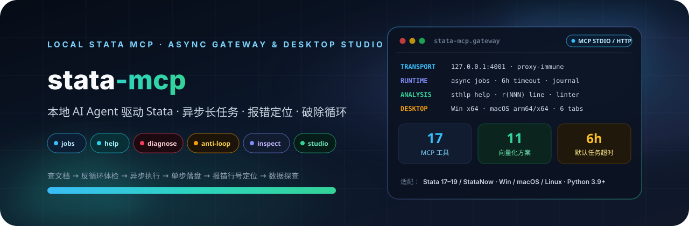

<p align="center">
  
</p>

# Stata-MCP

面向本地 AI Agent 的跨平台 **Stata MCP** 通用部署套件与 **Stata MCP Studio** 桌面控制台（支持 macOS / Linux / Windows）。将 [hanlulong/stata-mcp](https://github.com/hanlulong/stata-mcp)（MIT License，`v0.5.3`）核心引擎直接封装入安装包，与 17 工具本地网关**融合为单进程单端口服务（`127.0.0.1:4001`）**，提供零依赖代理免疫 stdio 桥接器、异步长任务单步落盘、精确到原文件行号的报错定位、反循环静态体检与离线 `.sthlp` 文档引擎，不耦合任何特定编辑器或 Agent 宿主。

适用场景：长耗时 `.do` 回归与数据清洗的异步执行、逐行报错自动定位修复、编写代码前离线查验 Stata/SSC 语法、拦截低效观测值循环并自动改写为向量化写法、实时探查内存数据集与 `e()`/`r()`/`c()` 存储结果。

- **不依赖任何特定软件**：安装器、桥接器、启停器全部采用**纯 Python 标准库**编写，macOS / Linux / Windows 同一套代码，不绑定任何 IDE、编辑器扩展或 MCP 网关。
- **不触碰他方配置**：默认仅输出或复制标准 JSON 配置片段，**绝不读取或改写其他产品的配置文件**；仅当显式传入 `--write-config PATH`（或在桌面端手动选择文件）时才合并单个条目，写前自动时间戳备份，遇到非法 JSON 直接拒绝。
- **不硬编码机器信息**：仓库内无用户名、盘符或特定客户端路径；Stata 安装根目录、Python/uv、端口与状态目录全部自动发现或参数化。

> 仓库内已直接内置精简版上游核心服务端（`server/`，来自 [hanlulong/stata-mcp](https://github.com/hanlulong/stata-mcp) `v0.5.3`，MIT License）：**无需在安装时 `git clone` GitHub 源码**，同时仍保留 `--server-dir` / `--mirror` 参数以兼容自定义上游覆盖。

---

## 能力矩阵（17 个 MCP 工具）

本地网关在保持上游核心执行能力的同时，将阻塞式运行升级为可中断、可增量追踪的后台作业，并内建零依赖静态分析与帮助引擎：

| 能力域 | MCP 工具 | 核心能力 |
|---|---|---|
| 异步执行与作业 | `stata_run_file`、`stata_run_selection`、`stata_run_lines` | 同名兼容；等待最多 `20s`，短任务直出结果，长任务返回 `job_id`；`stata_run_file` 支持 `lint=True` 预检；`stata_run_lines` 支持行区间复测且报错自动映射原文件行号 |
| 作业监控与控制 | `stata_job_status`、`stata_job_tail`、`stata_job_list`、`stata_job_cancel` | 查询状态与 `error_code`/`error_line`、按 `offset` 增量拉取单步预览（`steps`）或原始日志（`full`）、列出近期作业、向引擎 `/stop_execution` 终止任务 |
| 并行会话管理 | `stata_session` | 透传上游会话管理（`list` / `destroy`），多任务并行时通过不同 `session_id` 隔离 |
| Help 与命令探查 | `stata_help`、`stata_search_help`、`stata_which` | 离线读取本机 Stata/SSC `.sthlp` 文档，自动解析 `*help_alias.maint` 别名（如 `reg` → `regress`）与 `{INCLUDE}`、按章节（`syntax`/`options`/`examples`/`results`）提取；检查命令是否安装及 `.ado` 版本头 |
| 精确报错定位 | `stata_diagnose_error` | 解析 `#delimit ;`、`///` 续行、嵌套块注释与宏展开命令，跳过 `capture` 吞掉的错误，将致命 `r(NNN);` 精准映射到 1-based 行号、源码上下文与修复建议 |
| 破除循环与向量化 | `stata_lint_do`、`stata_vectorize_guide` | 静态拦截 `1/_N`、`levelsof/egen group` 循环、前向填充、宽表年份、跨变量缺失替换、`postfile`、`preserve` 循环、未排序下标与缺失值 `>` 陷阱；提供 15 类经真实 Stata 19.5 验证的向量化方案 |
| 内存数据探查 | `stata_inspect_data`、`stata_describe`、`stata_stored_results` | 直连 `/view_data` 预览数据表行列与类型；只读执行 `describe` + `summarize` + `misstable summarize`（支持内存数据或指定 `.dta` 文件）；查看 `e()`、`r()`、`c()` 与 `estimates dir` |

标准调用工作流（5 步闭环）：

```text
1. 读取数据 (stata_describe / stata_inspect_data)
   -> 2. 查询命令存在与帮助 (stata_which / stata_search_help / stata_help)
   -> 3. 撰写代码并运行 (stata_run_file / stata_run_selection / stata_job_tail)
   -> 4. 出错检查并重新运行 (stata_diagnose_error / stata_run_lines)
   -> 5. 破除循环增强可读性 (stata_lint_do / stata_vectorize_guide)
```

核心运行时与分析约定：

- **长任务不超时断流**：上游单次阻塞调用常被 MCP 客户端在 ~30s 截断；网关最多同步等待 `20s`（可配上限 `25s`），超时未完立即返回 `job_id`，后台继续运行（默认作业超时 `21600s` = 6 小时，可通过 `--default-timeout` 调整），每条 `. command` 实时落盘至 `~/.stata-mcp/jobs/<job_id>/journal.log` 与 `records.jsonl`（保留最近 200 个作业 / 7 天）。
- **代理免疫与无黑框后台常驻**：stdio 桥接器直接通过标准库 `http.client` 访问 `127.0.0.1`，完全绕过 `HTTP_PROXY` / `HTTPS_PROXY` / `ALL_PROXY`，杜绝本地代理（Clash / Surge / Mihomo 等）引发 `502 Bad Gateway`；Windows 后台融合进程采用 `CREATE_NO_WINDOW` + Job Breakaway 与 Win32 PID 探活，避免弹出或残留控制台黑框。

---

## 安装与初始化

> **环境要求**：支持 **Stata 17–19 / StataNow**（MP / SE / BE 均可，自动发现或手动指定）；支持 **Windows 10/11（x64）**、**macOS（Apple Silicon `arm64` / Intel `x64`）** 与 **Linux**；命令行部署需 **Python 3.8+**（服务端宿主运行环境需 **3.9+**，有 `uv` 时优先使用 `uv` 加速，否则回退 `venv` + `pip`）。

### 1. 桌面端一键安装：Stata MCP Studio（推荐）

从 [GitHub Releases](https://github.com/JingYangYuan/stata-mcp/releases/latest) 下载对应系统的安装包，内嵌全部运行时脚本与离线文档，无需手动敲命令：

| 平台与架构 | 安装包产物 | 说明 |
|---|---|---|
| Windows x64 | `Stata-MCP-Studio-<version>-windows-x64.exe` / `.zip` | NSIS 安装器与便携压缩包；自动适配 Windows Python / UTF-8 环境，托盘常驻、无控制台弹窗 |
| macOS Apple Silicon (`arm64`) | `Stata-MCP-Studio-<version>-macos-arm64.dmg` / `.zip` | 自动补全 Homebrew / Python GUI `PATH`；已执行 ad-hoc 深度签名 |
| macOS Intel (`x64`) | `Stata-MCP-Studio-<version>-macos-x64.dmg` / `.zip` | 同上 |

> **macOS 首次打开提示**：若浏览器下载的 `.dmg`/`.zip` 触发 Gatekeeper 隔离提示，将 `Stata MCP Studio.app` 拖入「应用程序」后在终端执行一次：
> ```bash
> xattr -cr "/Applications/Stata MCP Studio.app"
> ```

打开应用后按界面 **三步向导** 即可完成部署：① 确认自动探测到的 Stata 根目录（缺 Python / `uv` 时可直接点击内置**环境安装镜像**直达华为云/阿里云/官方下载页） → ② 选用可选 **PyPI 镜像加速源**（清华/阿里/中科大/腾讯/默认源）后点击「一键安装 / 重装」（已装实例升级点 `refresh`） → ③ 启动单端口融合服务并点击「端到端自检 (`verify`)」。

### 2. 命令行部署（CLI）

macOS / Linux：

```bash
git clone https://github.com/JingYangYuan/stata-mcp.git && cd stata-mcp
python3 install.py                       # 等价于 install：拉源码 → 建私有 venv → 启动双进程 → 打印配置片段
```

Windows（PowerShell 或 cmd）：

```powershell
git clone https://github.com/JingYangYuan/stata-mcp.git
cd stata-mcp
python install.py
```

常用部署参数与日常运维命令：

```bash
python3 install.py install --print-plan                                      # 只打印计划，不下载、不写盘、不启动
python3 install.py install --stata-path /path/to/Stata --port 4001
python3 install.py install --pip-index https://pypi.tuna.tsinghua.edu.cn/simple  # 使用清华 PyPI 镜像安装依赖
python3 install.py install --server-dir ~/src/stata-mcp                      # 可选：覆盖内置 server/，使用本地源码
python3 install.py install --venv /path/to/existing/venv                     # 复用已有虚拟环境
python3 install.py install --default-timeout 43200                           # 自定义默认长任务超时（秒）
```

| 命令 | 作用 |
|---|---|
| `install` | 部署内置 `server/` 源码（或 `--server-dir`）、创建私有 `venv`（支持 `--pip-index`）、启动单端口融合服务并打印客户端配置 |
| `refresh` | 已装实例原地升级：停止服务、同步最新 `bin/` 与内置 `server/`、更新 `state.json` 为单端口模式并重启 |
| `config` | 打印 / 落盘（`--emit`）/ 非破坏合并（`--write-config`）客户端配置；支持 `--transport stdio\|http`、`--root`、`--key`、`--timeout-ms` |
| `start` / `stop` | 后台启动 / 停止单端口融合服务（幂等） |
| `status` | 安装摘要 + 单端口 `/health` 健康检查（支持 `--json`） |
| `verify` | 经 stdio 桥接跑端到端自检：校验 ≥17 工具清单、`display 1+1`、`stata_job_list` 与 `stata_help("regress")` |
| `doctor` | 环境诊断（OS、Python、git/uv、Stata 候选、双进程健康、jobs 目录统计与 `STATA_MCP_*` 变量，支持 `--json`） |
| `privacy` | 打印完整数据流与文件触碰声明 |
| `uninstall` | 停止服务并清理运行时目录（加 `--purge` 连同整个状态目录一并删除） |

所有命令均支持 `--home DIR`（默认 `~/.stata-mcp`，或环境变量 `STATA_MCP_HOME`）。

---

## 接入任意 MCP 客户端

运行 `python3 install.py config` 会生成标准 `stdio` 配置片段（推荐，自带代理免疫与未运行时自动拉起能力）：

```json
{
  "mcpServers": {
    "stata-mcp": {
      "command": "/path/to/.stata-mcp/venv/bin/python",
      "args": ["/path/to/.stata-mcp/bin/stata-mcp-bridge.py"]
    }
  }
}
```

Windows 下对应的 `command` 与 `args` 会自动输出 `~\.stata-mcp\venv\Scripts\python.exe` 与 `~\.stata-mcp\bin\stata-mcp-bridge.py`。

也可生成 `Streamable HTTP` 配置、适配嵌套键名（如 ZCode 的 `mcp.servers`）或显式注入超时并安全写入：

```bash
python3 install.py config --transport http --port 4001 --timeout-ms 120000
python3 install.py config --root mcp.servers --key stata-mcp
python3 install.py config --write-config /path/to/client.json --dry-run   # 预演检查，不改文件
python3 install.py config --write-config /path/to/client.json             # 原子合并写入，写前自动生成 .bak-YYYYMMDD-HHMMSS 备份
```

> 客户端名称无关紧要，只要支持标准 MCP `stdio` 或 `Streamable HTTP` 配置即可粘贴使用；更多多客户端嵌套根键与安全写入细节见 [docs/CONFIG.md](docs/CONFIG.md)。

---

## 工作机制、桌面工作区与隐私模型

### 运行时架构

```text
MCP 客户端 ──stdio──> bin/stata-mcp-bridge.py ──HTTP(127.0.0.1:4001)──> 单进程融合服务
                                │                                        ├─ /mcp-streamable: 17 工具网关 (stata-mcp-jobs.py)
                                │ (未运行时自动拉起)                      └─ 内部路由 + Stata worker (server/src/stata_mcp_server.py)
                                v
                       bin/stata-mcp-start.py

支持 Streamable HTTP 的客户端 ──HTTP(127.0.0.1:4001/mcp-streamable)─────┘
```

### Stata MCP Studio 桌面端工作区（3 大精简页面）

| 工作区 | 提供的能力 |
|---|---|
| 配置 | 极致单屏 3 行（Stata 路径探测、`:4001` 本地服务一键安装/启停/自检、MCP 配置复制）；环境下载镜像（华为云/阿里云/官方）、PyPI 加速源、文件合并写入、端口与卸载收于右上角「高级设置」抽屉 |
| 科研终端 | 管理常用科研项目目录（自动扫描 `.do`/`.dta` 数量），支持按平台自由选择默认终端应用（macOS 支持 Ghostty、iTerm2、WezTerm、Kitty、Alacritty、Warp、Terminal.app；Windows 支持 Windows Terminal、PowerShell 7、Git Bash、WezTerm、Alacritty、PowerShell、CMD；Linux 支持主流终端），一键在选定目录直接单窗口拉起 Claude Code、Codex、Gemini CLI、Antigravity、Cursor、VS Code、Windsurf、Trae、默认终端或自定义命令，启动前自动确保 `:4001` 在线 |
| 实证监控 | 单列倒序可展开时间线实时追踪 Stata 作业、失败时高亮原 `.do` 精确报错行号与修复建议、一键中止运行中作业，右上角弹窗查看 `server.log` |

### 私有状态目录与隐私保证

所有运行产物均集中在单一私有目录（默认 `~/.stata-mcp`，目录 `0700`、文件 `0600`）：

```text
~/.stata-mcp/
├── state.json            安装记录（路径、端口、解释器；不含任何密钥）
├── server/               上游服务端源码检出（仅 git clone 时写入）
├── venv/                 服务端专用 Python 虚拟环境
├── bin/                  stata-mcp-jobs.py（17 工具网关）、stata_mcp_analysis.py（分析引擎）、
│                         stata-mcp-bridge.py（stdio↔HTTP）、stata-mcp-start.py（启停）、可执行 shim
├── cache/selection/      代码片段与行区间临时暂存目录（超过 2 天自动清理）
├── jobs/<job_id>/        单步日志：records.jsonl、journal.log、meta.json、error.json（失败时）
├── logs/                 server.log、gateway.log 及 *.console.log
└── run/                  server.pid、jobs.pid
```

- **零遥测、零外联**：除你显式触发的源码 clone 与依赖安装外，运行时只访问本机 `127.0.0.1` 回环端口，无遥测、无远程日志、无更新探测。
- **最小权限读写**：只读 Stata 发现所需的程序目录、`PATH`、Windows 卸载注册表项与 `.sthlp`/`.ado`；只写 `~/.stata-mcp/` 与你显式通过 `--write-config` 指定的单个文件。
- **零密钥暴露**：`doctor` 仅输出本项目自用的 `STATA_MCP_*` 变量，`.gitignore` 默认拦截日志、数据集、`.env` 与 `.bak-*` 备份。完整声明可运行 `python3 install.py privacy` 或查阅 [docs/PRIVACY.md](docs/PRIVACY.md)。

---

## 测试与本地开发

运行全套 Python 与桌面端单元测试（零 Stata 实机依赖，可在 CI 中直接跑完）：

```bash
python3 -m unittest discover -s tests -v              # 核心 CLI、分析引擎、报错定位、Windows 兼容与实机 Stata 等价测试（无 Stata 自动跳过）
pnpm --dir desktop install --no-frozen-lockfile
pnpm --dir desktop test                               # 桌面端 CoreService、页面配置与 UI 回归测试
pnpm --dir desktop run prepare:core                   # 组装内置 stata-mcp-core 载荷
pnpm --dir desktop run verify:core                    # 校验 13 个必需核心脚本与模块完整
```

本地打包桌面端安装包（CI 通过 [.github/workflows/build-desktop.yml](.github/workflows/build-desktop.yml) 在推送 `main` 或 `v*` 标签时自动跨平台构建并发布 Release）：

```bash
pnpm --dir desktop run package:win                    # Windows x64 NSIS + zip
pnpm --dir desktop run package:mac:arm64              # macOS Apple Silicon dmg + zip
pnpm --dir desktop run package:mac:x64                # macOS Intel dmg + zip
```

实机端到端冒烟验证（需本机已安装 Stata 且已运行 `install.py`）：

```bash
python3 install.py verify                             # 经 stdio 桥接完整验证 17 工具、Stata 计算、作业查询与 Help
```

---

## 故障排查

- **开着 Clash / Surge / Mihomo 等代理时客户端报 `502`**：使用默认的 `stdio` 配置（经 `stata-mcp-bridge.py` 直连回环口，永不走代理）；若必须使用 HTTP 模式，请将 `127.0.0.1` 与 `localhost` 加入代理绕过列表。
- **未找到 Stata 或选中了旧版本**：通过 `python3 install.py doctor` 查看全部探测候选，在安装或桌面端向导中手动指定 Stata 安装根目录（例如 `/Applications/StataNow` 或 `E:\Stata19`）。
- **端口 `4001` 已被其他服务占用**：传入 `--port 4011`，或在桌面端出现端口冲突提示时点击「改用端口 4011」（单端口模式不再占用 `4002`）。
- **内网或下载 Python 依赖较慢**：在桌面端第 2 步直接点击清华/阿里云/中科大/腾讯云 PyPI 镜像按钮，或命令行传入 `--pip-index https://pypi.tuna.tsinghua.edu.cn/simple`；缺失 Python/`uv` 时可在桌面端第 1 步点击环境镜像按钮直达下载。
- **排查后台运行异常**：依次检查 `python3 install.py doctor`，以及 `~/.stata-mcp/logs/gateway.log`、`~/.stata-mcp/logs/server.log` 与 `*.console.log`；更多排查步骤见 [docs/TROUBLESHOOTING.md](docs/TROUBLESHOOTING.md)。

---

## 仓库目录结构

```text
stata-mcp/
├── .github/workflows/
│   ├── ci.yml                         # Ubuntu/macOS/Windows Python 3.9/3.12 与桌面端回归 CI
│   └── build-desktop.yml              # 跨平台打包 Windows/macOS 安装包并自动发布 Release
├── bin/
│   ├── stata-mcp-bridge.py            # 零依赖代理免疫 stdio <-> Streamable HTTP 桥接器
│   ├── stata-mcp-jobs.py              # 17 工具本地网关与异步作业引擎（journal.log）
│   ├── stata-mcp-start.py             # 跨平台双进程后台启停与状态探测脚本
│   └── stata_mcp_analysis.py          # 零依赖 Help 渲染、精确报错行号定位与反循环体检
├── desktop/
│   ├── app/                           # Electron 主进程、preload、CoreService 与 6 工作区界面
│   ├── assets/                        # 应用图标（icns / ico / png / svg）
│   ├── scripts/                       # prepare-core / verify-core / macOS ad-hoc afterPack 签名
│   ├── tests/core-service.test.mjs    # 桌面端单元测试
│   └── package.json                   # Electron + electron-builder 配置
├── docs/
│   ├── banner.svg                     # 仓库视觉横幅
│   ├── ARCHITECTURE.md                # 组件架构与分层设计
│   ├── COMPATIBILITY.md               # 平台、Stata 版本与客户端兼容性
│   ├── CONFIG.md                      # 配置片段与非破坏写入语义
│   ├── PRIVACY.md                     # 数据流、权限与文件触碰声明
│   └── TROUBLESHOOTING.md             # 常见故障与排查指南
├── stata_mcp_local/
│   ├── cli.py                         # install / refresh / config / start / stop / status / verify / doctor / privacy / uninstall
│   ├── config_emit.py                 # MCP 客户端配置生成与原子安全合并
│   ├── paths.py                       # 私有状态目录布局与 Windows 只读目录强删
│   ├── runtime.py                     # Python/uv 探测、venv 创建与跨平台进程控制
│   ├── source.py                      # 上游源码定位与原子暂存克隆
│   ├── stata.py                       # 跨平台 Stata 探测（目录/PATH/环境变量/Windows 注册表）
│   └── ui.py                          # 终端着色输出辅助
├── tests/
│   ├── test_analysis.py               # Help 引擎、报错行号定位与反循环拦截测试
│   ├── test_gateway_and_cli.py        # CLI、配置合并、5 步流程指令与网关作业测试
│   └── test_stata_real_loops.py       # 15 类破除循环模式的真实 Stata 等价性与性能基准测试
├── install.py                         # 统一 CLI 入口（纯标准库）
├── LICENSE                            # MIT License
└── README.md
```

---

## 文档与许可

- [docs/ARCHITECTURE.md](docs/ARCHITECTURE.md) — 组件架构、生命周期与分层原因
- [docs/CONFIG.md](docs/CONFIG.md) — 配置片段、传输模式选择与安全写入语义
- [docs/PRIVACY.md](docs/PRIVACY.md) — 数据流与文件触碰声明、审计方式
- [docs/COMPATIBILITY.md](docs/COMPATIBILITY.md) — 操作系统、Stata 版本与 MCP 客户端兼容性
- [docs/TROUBLESHOOTING.md](docs/TROUBLESHOOTING.md) — 常见故障与排查方法

本仓库（部署器、网关、分析引擎与桌面控制台）采用 [MIT License](LICENSE)，Copyright (c) 2026 JingYangYuan。

内置 `server/` 核心服务端源码来自 [hanlulong/stata-mcp](https://github.com/hanlulong/stata-mcp) `v0.5.3`（MIT License，版权归 Han Lulong 等作者所有），其原始许可证保留于 [server/LICENSE](server/LICENSE)。
